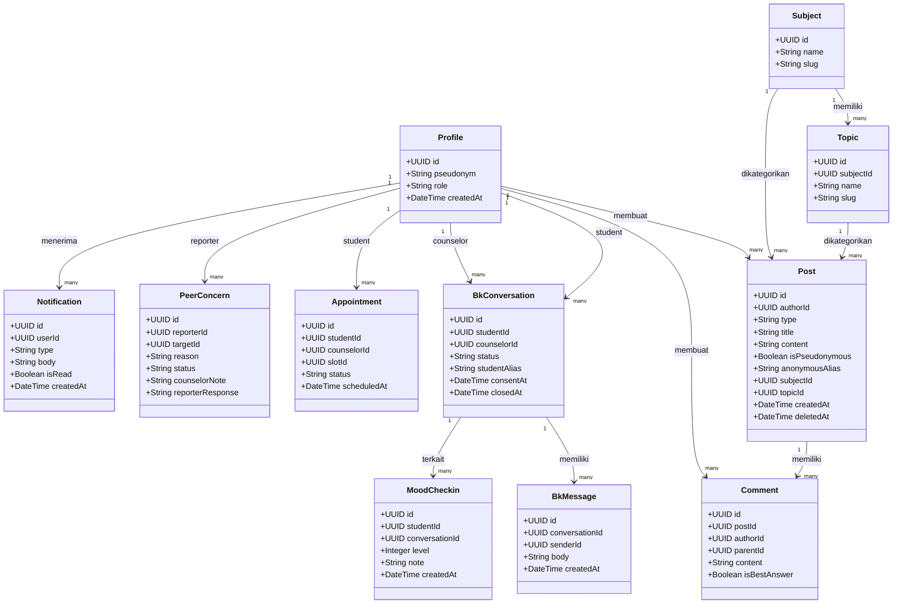
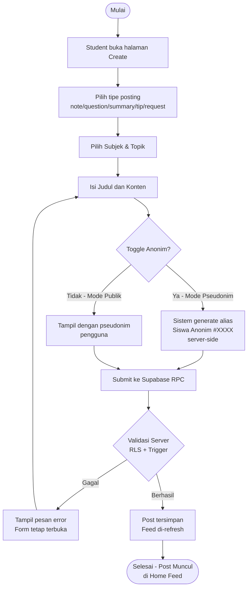
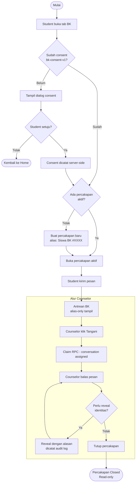
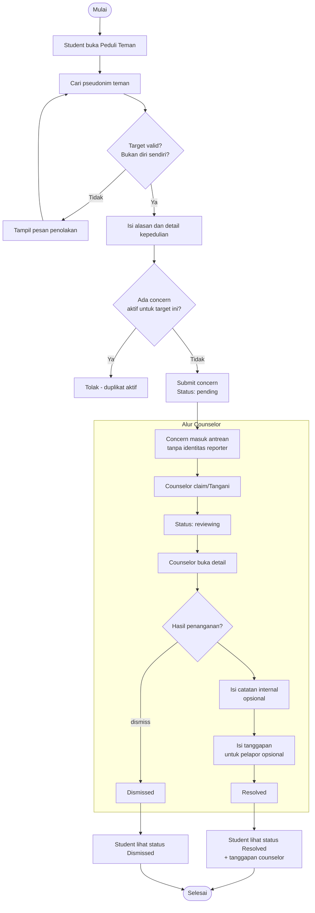
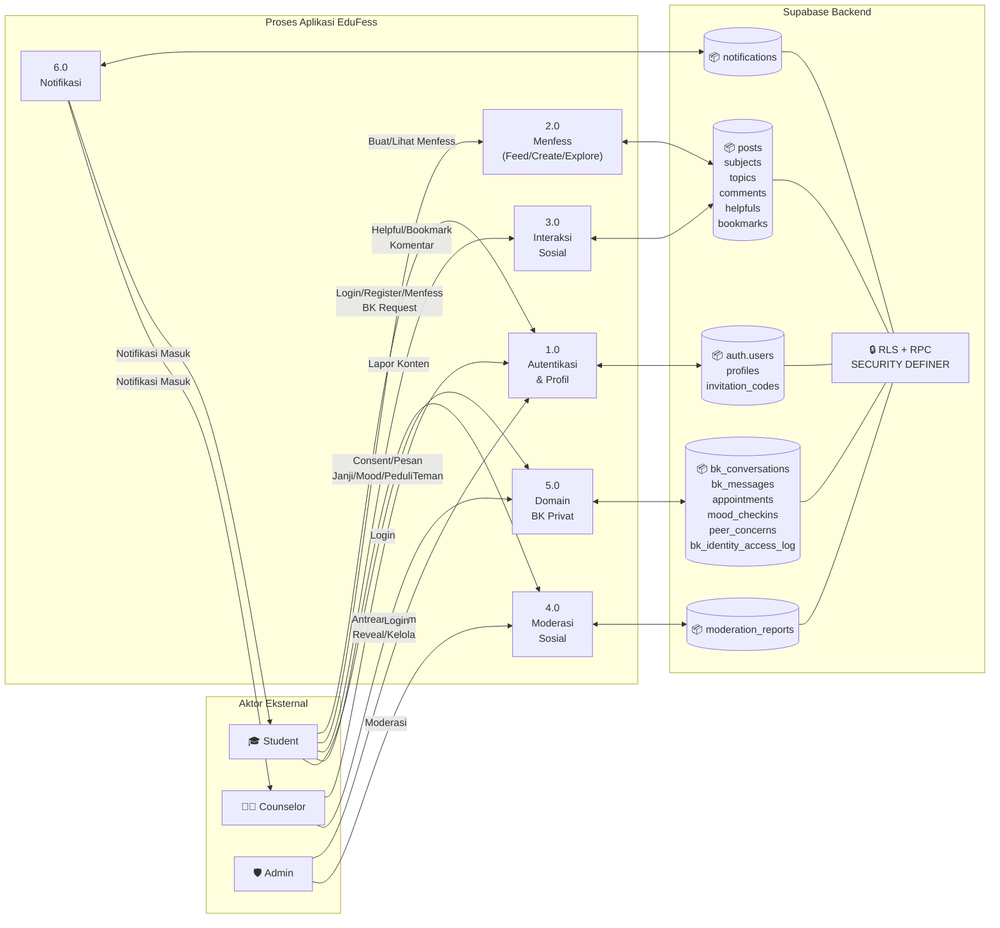
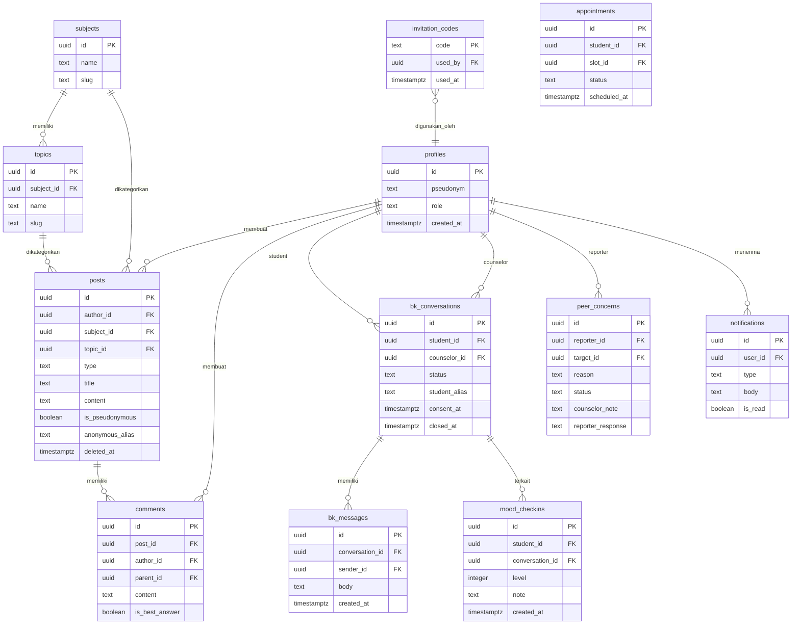
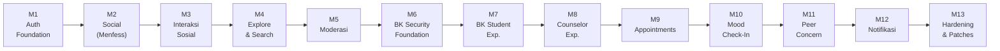

# MOBILE PROGRAMMING
# PRODUCT REQUIREMENTS DOCUMENT (PRD) & SOFTWARE REQUIREMENTS DOCUMENT (SRD)
# APLIKASI EDUFESS
### Version 2.0 — Final

**Mata Kuliah:** Mobile Programming  
**Dosen Pengampu:** Ghea Chandra Surawan, M.Pd.

| | |
|---|---|
| **Nama** | Mila Novelia |
| **NPM** | 2413025051 |
| **Kelas** | PTI A |

**PROGRAM STUDI PENDIDIKAN TEKNOLOGI INFORMASI**  
JURUSAN PENDIDIKAN MATEMATIKA DAN ILMU PENGETAHUAN ALAM  
FAKULTAS KEGURUAN DAN ILMU PENDIDIKAN  
UNIVERSITAS LAMPUNG  
2026

---

## DAFTAR ISI

- [BAB I — PENDAHULUAN](#bab-i--pendahuluan)
- [BAB II — PRODUCT REQUIREMENTS DOCUMENT (PRD)](#bab-ii--product-requirements-document-prd)
- [BAB III — SOFTWARE REQUIREMENTS DOCUMENT (SRD)](#bab-iii--software-requirements-document-srd)
- [BAB IV — TIMELINE, IMPLEMENTASI, DAN MANAJEMEN PROYEK](#bab-iv--timeline-implementasi-dan-manajemen-proyek)
- [BAB V — SPESIFIKASI USE CASE UTAMA](#bab-v--spesifikasi-use-case-utama)
- [BAB VI — KEAMANAN DAN PRIVASI](#bab-vi--keamanan-dan-privasi)
- [BAB VII — KESIMPULAN](#bab-vii--kesimpulan)

---

## BAB I — PENDAHULUAN

### 1. Latar Belakang

Di lingkungan sekolah, siswa sering kesulitan menemukan ruang yang tepat untuk berbagi catatan pelajaran, bertanya tentang materi yang belum dipahami, atau sekadar berbagi tips belajar — terutama ketika mereka ingin melakukannya tanpa harus mengekspos identitas asli. Aplikasi media sosial umum tidak dirancang untuk konteks akademik, sedangkan platform LMS (Learning Management System) terlalu formal dan tidak mendorong interaksi spontan antar siswa.

Di sisi lain, akses ke layanan Bimbingan Konseling (BK) di sekolah sering kali terasa berat bagi siswa — ada hambatan psikologis untuk datang langsung. Siswa membutuhkan kanal yang lebih privat dan tidak mencolok untuk memulai komunikasi dengan guru BK.

**EduFess** hadir untuk menjawab kedua kebutuhan ini dalam satu aplikasi mobile. Nama "EduFess" berasal dari gabungan kata **Education** dan **Confess (Menfess)** — mencerminkan dua pilar utama aplikasi:

> [!IMPORTANT]
> ### 🌟 Pilar Utama 1 — MENFESS (Knowledge Sharing Feed)
> Fitur **Menfess** adalah fitur **paling utama dan paling pertama** yang dirasakan setiap pengguna EduFess. Menfess memungkinkan siswa untuk:
> - Membagikan catatan, pertanyaan, rangkuman, tips, dan permintaan bantuan di feed komunitas
> - Memilih tampil **secara publik** (dengan pseudonim) atau **secara anonim** (alias "Siswa Anonim #XXXX" yang dibuat otomatis oleh server — bukan oleh klien)
> - Berinteraksi lewat **Helpful** (seperti "like"), **Bookmark**, **Komentar**, **Reply**, **Best Answer**, dan **Laporan**
> - Mencari dan memfilter postingan berdasarkan mata pelajaran, topik, dan tipe konten
>
> Menfess adalah jantung komunitas EduFess. Tanpa Menfess, EduFess tidak lebih dari sekadar aplikasi konseling biasa.

> [!NOTE]
> ### 🔒 Pilar Utama 2 — BK Privat (Bimbingan Konseling Digital)
> Sebagai pelengkap, EduFess menyediakan jalur **privat dan terenkapsulasi** menuju layanan BK sekolah — terpisah sepenuhnya dari feed sosial. Fitur BK mencakup percakapan privat, booking janji konseling, Mood Check-In, dan Peduli Teman.

### 2. Ruang Lingkup Dokumen

#### 2.1 Tujuan Produk
1. 🌟 **[UTAMA]** Menyediakan **sistem Menfess** — ruang komunitas sekolah untuk berbagi catatan, pertanyaan, ringkasan, tips, dan permintaan bantuan secara anonim maupun publik.
2. Menyediakan fitur **Explore & Search** untuk mencari dan memfilter konten Menfess berdasarkan kata kunci, mata pelajaran, topik, dan tipe.
3. Menyediakan ruang BK privat sebagai **pelengkap** dari Menfess — terpisah dari ruang sosial, dengan prinsip pseudonim dan pembatasan akses berbasis peran.
4. Menyediakan fitur BK lanjutan: janji konseling, Mood Check-In, dan Peduli Teman sebagai dukungan non-diagnostik.
5. Menyediakan moderasi sosial bagi admin untuk menjaga kualitas konten Menfess.

#### 2.2 Manfaat Produk
- **Bagi siswa:** bebas berbagi pengetahuan secara anonim atau publik (Menfess), berdiskusi akademik, mendapat jawaban dari teman, serta mengakses layanan BK jika diperlukan — semuanya dalam satu aplikasi.
- **Bagi komunitas sekolah:** terbentuk bank pengetahuan kolektif (catatan, tips, rangkuman) yang dapat dicari dan dimanfaatkan ulang.
- **Bagi guru BK:** menyediakan antrean konseling, percakapan privat, pengelolaan ketersediaan, jadwal, riwayat mood siswa, serta Peduli Teman.
- **Bagi admin:** menyediakan moderasi konten Menfess dengan batas yang jelas dari data privat BK.
- **Bagi pengembang:** struktur proyek feature-first yang sederhana, modular, dan dapat diuji.

#### 2.3 Batasan Produk
- EduFess dikembangkan sebagai aplikasi Android-first. Platform web/desktop belum menjadi target implementasi utama.
- Aplikasi bukan Learning Management System penuh; tidak terdapat fitur kelas, nilai, absensi, atau manajemen tugas pembelajaran lengkap.
- Fitur Mood Check-In bersifat **non-diagnostik** dan tidak melakukan penilaian medis, diagnosis, maupun risk scoring otomatis.
- Admin sosial tidak otomatis memperoleh akses ke percakapan, mood, janji, maupun laporan Peduli Teman pada domain BK.
- Pseudonim tidak sama dengan anonimitas mutlak karena identitas pengguna tetap disimpan di backend untuk kebutuhan keamanan dan audit.

### 3. Definisi, Istilah, dan Singkatan

| Istilah / Singkatan | Definisi |
|---|---|
| **PRD** | Product Requirements Document |
| **SRD** | Software Requirements Document |
| **EduFess** | Aplikasi komunitas pengetahuan sekolah dengan ruang privat BK |
| **Menfess** | *Mention Confess* — sistem posting anonim/pseudonim ala media sosial yang menjadi fitur utama feed EduFess |
| **Student** | Peran siswa; role default pada pendaftaran publik |
| **Counselor** | Peran guru BK yang menangani antrean, percakapan, janji, mood, dan Peduli Teman |
| **Admin** | Peran yang menangani moderasi sosial; tidak otomatis memiliki akses ke data BK |
| **BK** | Bimbingan Konseling, domain privat yang dipisahkan dari fitur sosial |
| **Pseudonim** | Nama tampilan yang digunakan untuk mengurangi paparan identitas asli |
| **Alias Anonim** | Nama tampilan acak server-side untuk posting pseudonim, contoh: "Siswa Anonim #A1B2" |
| **RLS** | Row Level Security pada PostgreSQL/Supabase |
| **RPC** | Remote Procedure Call pada PostgreSQL/Supabase |
| **Riverpod** | Library state management Flutter |
| **go_router** | Library navigasi dan routing Flutter |
| **Mood Check-In** | Pencatatan kondisi mood skala 1–5 secara non-diagnostik |
| **Peduli Teman** | Fitur laporan privat kepada BK ketika siswa memiliki kekhawatiran terhadap teman |
| **Helpful** | Penanda bahwa suatu postingan dianggap membantu (seperti "like") |
| **Soft Delete** | Penghapusan secara logis tanpa langsung menghilangkan data secara fisik |
| **Invitation Code** | Kode undangan sekali pakai yang dibutuhkan untuk registrasi |

### 4. Aturan Penomoran

- Bab utama menggunakan angka Romawi (BAB I, BAB II, dst.)
- Sub-bab menggunakan angka (1, 2, 3, dst.)
- Sub-sub-bab menggunakan penomoran bertingkat (2.1, 2.2, dst.)
- Kebutuhan fungsional: kode **SRD-F-XXX**
- Kebutuhan non-fungsional: kode **SRD-NF-XXX**
- Use case: kode **UC-XX**

---

## BAB II — PRODUCT REQUIREMENTS DOCUMENT (PRD)

### 1. Gambaran Umum Produk

EduFess adalah aplikasi mobile komunitas sekolah yang menggunakan **Flutter** pada sisi klien dan **Supabase** pada sisi backend. Nama "EduFess" mencerminkan identitas aplikasi: **Education + Fess (Confess/Menfess)**.

---

### 🌟 FITUR UTAMA: SISTEM MENFESS

> Menfess adalah fitur **nomor satu** EduFess. Sebelum ada BK, sebelum ada konseling — ada Menfess.

**Apa itu Menfess di EduFess?**

Menfess (dari *Mention + Confess*) adalah sistem posting komunitas sekolah yang terinspirasi dari budaya "fess" di media sosial Indonesia — di mana orang berbagi informasi, pertanyaan, atau curhatan secara anonim. EduFess mengadaptasikan konsep ini untuk konteks pendidikan:

| Aspek | Di EduFess |
|---|---|
| **Siapa yang bisa posting?** | Semua siswa yang sudah login |
| **Apa yang bisa diposting?** | 📝 Catatan · ❓ Pertanyaan · 📖 Rangkuman · 💡 Tips · 🙏 Permintaan bantuan |
| **Mode identitas** | **Publik** (tampil dengan pseudonim) atau **Anonim** (alias "Siswa Anonim #XXXX" dibuat server-side) |
| **Interaksi** | Helpful ❤️ · Bookmark 🔖 · Komentar 💬 · Reply · Best Answer ✅ · Laporan 🚩 |
| **Pencarian** | Filter mata pelajaran, topik, tipe posting, kata kunci — dengan debounce |
| **Edit & Hapus** | Author bisa edit judul/konten/tipe dan hapus postingan milik sendiri |

**Keunggulan Menfess EduFess:**
- ✅ **Alias anonim dibuat server-side** — klien tidak bisa memalsukan alias; setiap posting anonim mendapat kode unik yang konsisten (contoh: "Siswa Anonim #A1B2")
- ✅ **Identitas backend tetap terjaga** — meski tampil anonim di feed, server tahu siapa authornya untuk keperluan moderasi
- ✅ **Feed real-time** dengan pull-to-refresh dan state loading/error/empty yang jelas
- ✅ **Best Answer** — untuk posting bertipe *Pertanyaan*, author bisa menandai jawaban terbaik
- ✅ **Sistem Subject & Topic** — posting dikategorikan per mata pelajaran (Informatika, Matematika, Bahasa Inggris, dll.) dan topik (Algoritma, Pemrograman, dst.)

---

> [!NOTE]
> **Konsep Inti — Mengapa Menfess dulu, BK belakangan?**
>
> Urutan ini disengaja. Menfess adalah fitur yang dirasakan **semua siswa setiap hari** — berbagi catatan, bertanya tentang PR, mencari tips ujian. BK adalah fitur yang dibutuhkan **sebagian siswa pada momen tertentu**. EduFess dirancang agar siswa datang untuk Menfess-nya, dan menemukan layanan BK ketika membutuhkan. Tanpa komunitas Menfess yang aktif, tab BK tidak akan pernah dibuka.

Navigasi utama menggunakan lima tab:
1. **🏠 Home** — Feed Menfess (postingan terbaru dari komunitas)
2. **🔍 Explore** — Cari dan filter postingan Menfess
3. **✏️ Create** — Buat Menfess baru (publik atau anonim)
4. **💬 BK** — Layanan bimbingan konseling privat
5. **👤 Profile** — Profil pengguna dan pengaturan

### 2. Pengguna Sasaran dan Hak Akses

| Aktor | Karakteristik | Hak Akses Utama | Pembatasan |
|---|---|---|---|
| **Student** | Siswa yang terdaftar menggunakan invitation code | Feed Menfess, Explore, Create Menfess, Helpful, Bookmark, Report, BK (setelah consent), Janji, Mood, Peduli Teman, Notifikasi | Tidak dapat mengubah role sendiri, tidak akses data BK siswa lain, tidak bisa jadi counselor/admin |
| **Counselor** | Guru BK yang diprovisikan operator | Antrean konseling, claim percakapan, pesan siswa yang ditangani, ketersediaan, janji, mood history, Peduli Teman, reveal identitas | Tidak otomatis jadi moderator sosial; tidak bebas membaca kasus counselor lain |
| **Admin** | Pengelola moderasi sosial | Antrean laporan sosial, dismiss/remove konten, akses profil sendiri | Tidak otomatis dapat membaca percakapan BK, mood, janji, atau Peduli Teman |

### 3. Ruang Lingkup dan Batasan Produk

- Aplikasi bergantung pada koneksi jaringan untuk autentikasi, membaca feed, pencarian, serta seluruh operasi BK dan notifikasi.
- Backend menggunakan Supabase Auth dan PostgreSQL; tidak terdapat `service_role` key pada aplikasi Flutter.
- Pendaftaran publik selalu menghasilkan role **student** dan membutuhkan invitation code sekali pakai.
- Satu siswa dibatasi memiliki satu percakapan konseling aktif pada satu waktu.
- Mood Check-In bersifat append-only; riwayat lama tidak diedit secara bebas.

### 4. Fitur Utama Produk

> [!IMPORTANT]
> **Hierarki Fitur EduFess:** Menfess adalah fondasi utama. BK adalah pelengkap strategis.

```
EduFess
├── 🌟 MENFESS (Fitur Utama — diakses semua user setiap hari)
│   ├── Feed (Home) — lihat postingan komunitas
│   ├── Create — buat Menfess (publik/anonim)
│   ├── Explore — cari & filter Menfess
│   ├── Interaksi — Helpful, Bookmark, Komentar, Reply, Best Answer
│   ├── Moderasi — lapor konten, admin queue
│   └── Edit & Delete — author bisa ubah/hapus post sendiri
│
└── 🔒 BK PRIVAT (Fitur Pelengkap — diakses saat dibutuhkan)
    ├── Percakapan privat student-counselor
    ├── Booking janji konseling
    ├── Mood Check-In (non-diagnostik)
    └── Peduli Teman
```

| Prioritas | Kelompok Fitur | Deskripsi | Status |
|---|---|---|---|
| 🥇 **#1 Utama** | **🌟 Menfess Feed** | Feed komunitas posting anonim/publik: note, question, summary, tip, request. Tampilan bertipe media sosial | ✅ Selesai |
| 🥇 **#1 Utama** | **🌟 Buat Menfess** | Form posting dengan toggle anonim; alias server-side "Siswa Anonim #XXXX" | ✅ Selesai |
| 🥇 **#1 Utama** | **🌟 Interaksi Menfess** | Helpful ❤️, Bookmark 🔖, Komentar 💬, Reply, Best Answer ✅, Edit & Hapus post sendiri | ✅ Selesai |
| 🥇 **#1 Utama** | **🌟 Explore & Search** | Pencarian debounce, filter mata pelajaran/topik/tipe, sorting, pagination, recent search | ✅ Selesai |
| 🥈 **#2 Pendukung** | Autentikasi & Profil | Registrasi via invitation code, login/logout, session, pseudonim, role | ✅ Selesai |
| 🥈 **#2 Pendukung** | Moderasi Sosial | Antrean laporan Menfess, dismiss/remove konten oleh admin | ✅ Selesai |
| 🥉 **#3 Pelengkap** | Konseling BK Privat | Consent BK, percakapan privat student-counselor, antrean & claim, reveal identitas teraudit | ✅ Selesai |
| 🥉 **#3 Pelengkap** | Janji & Ketersediaan | Booking janji oleh student, pengelolaan slot & triage oleh counselor | ✅ Selesai |
| 🥉 **#3 Pelengkap** | Mood Check-In | Pencatatan mood skala 1–5, riwayat & tren, read-only bagi counselor berwenang | ✅ Selesai |
| 🥉 **#3 Pelengkap** | Peduli Teman | Laporan kepedulian privat ke BK, antrean counselor, penanganan & respons | ✅ Selesai |
| 🥉 **#3 Pelengkap** | Notifikasi | Unread indicator, mark read/all, pesan generik untuk data sensitif, deep link | ✅ Selesai |

### 5. Lingkungan Operasi

#### 5.1 Sisi Pengembang
- Flutter 3.47.0 dan Dart ^3.13.0
- Android SDK dan perangkat Android fisik/emulator
- Supabase CLI untuk migration dan verification SQL
- Git untuk version control

#### 5.2 Sisi Pengguna
- Perangkat Android
- Koneksi internet untuk autentikasi dan sinkronisasi data
- Antarmuka dirancang untuk orientasi layar ponsel (single-column, navigasi bawah)

### 6. Teknologi dan Arsitektur

| Teknologi | Versi | Fungsi |
|---|---|---|
| Flutter / Dart | Flutter 3.47.0 / Dart ^3.13.0 | Pembuatan aplikasi mobile dan UI |
| flutter_riverpod | ^3.4.2 | State management dan provider |
| go_router | ^18.0.0 | Routing dan navigasi |
| supabase_flutter | ^2.17.2 | Integrasi autentikasi dan database Supabase |
| flutter_dotenv | ^6.0.1 | Memuat konfigurasi SUPABASE_URL dan SUPABASE_ANON_KEY |
| PostgreSQL / Supabase | Backend | Penyimpanan data, RLS, trigger, RPC, dan audit |
| Material 3 | Tema aplikasi | Komponen visual (Card, NavigationBar, FilledButton, dll.) |

**Arsitektur proyek** menggunakan pendekatan **feature-first**:

```
lib/
  app/          ← Wiring: router, shell, theme
  core/         ← Shared: config, constants, errors, widgets
  features/
    auth/       ← Login, Register
    feed/       ← Home (Menfess Feed), Post Detail
    explore/    ← Search & Filter
    create_post/← Buat Menfess Baru
    counseling/ ← BK: conversation, appointments, mood, peer concern
    moderation/ ← Admin moderation queue
    notifications/
    profile/
    saved/
supabase/
  migrations/   ← 34 migration SQL (M1–M13 + patches)
  verification/ ← SQL security tests
test/           ← 211 unit & widget tests
```

---

## BAB III — SOFTWARE REQUIREMENTS DOCUMENT (SRD)

### 1. Kebutuhan Antarmuka

| No | Halaman | Aktor | Keterangan |
|---|---|---|---|
| 1 | **Login** | Semua pengguna | Form email dan password, validasi, indikator loading, pesan error |
| 2 | **Register** | Student | Email, password, pseudonim, invitation code; role selalu student |
| 3 | **Home (Feed Menfess)** | Student/Counselor/Admin | Feed postingan publik & pseudonim, AppBar EduFess, notifikasi badge, pull-to-refresh, empty/error state |
| 4 | **Create (Buat Menfess)** | Student | Form tipe posting (note/question/summary/tip/request), subjek, topik, judul, konten, toggle pseudonim anonim |
| 5 | **Post Detail** | Semua pengguna login | Isi postingan, komentar, reply, helpful, bookmark, best answer, report |
| 6 | **Explore** | Semua pengguna login | Pencarian debounce, filter subjek/topik/tipe, sorting, pagination, recent search |
| 7 | **Saved** | Student | Daftar postingan yang dibookmark |
| 8 | **Moderation** | Admin | Antrean laporan sosial, dismiss/remove, konfirmasi tindakan |
| 9 | **BK Landing** | Student/Counselor | Student: consent dan akses layanan; Counselor: antrean dan ditangani; Admin ditolak |
| 10 | **BK Conversation** | Student/Counselor | Header status/alias, daftar pesan, composer, close/reveal (counselor) |
| 11 | **Appointments Student** | Student | Daftar janji, tombol Buat Janji, dialog slot, pembatalan |
| 12 | **Availability Counselor** | Counselor | Tambah/edit/nonaktifkan ketersediaan; time picker dial-only |
| 13 | **Appointments Counselor** | Counselor | Tab status janji, accept/reject/reschedule/completed |
| 14 | **Mood Check-In** | Student | Pilihan mood 1–5, catatan opsional, riwayat dan tren |
| 15 | **Mood History Counselor** | Counselor | Riwayat mood siswa yang ditangani, bersifat read-only |
| 16 | **Peduli Teman Student** | Student | Cari pseudonim teman, alasan, detail, kirim concern, riwayat status dan tanggapan counselor |
| 17 | **Peduli Teman Counselor** | Counselor | Antrean, claim/Tangani, detail, resolve/dismiss, catatan internal dan tanggapan pelapor |
| 18 | **Notifications** | Semua pengguna login | Daftar notifikasi, unread state, mark read/all, deep link |
| 19 | **Profile** | Semua pengguna login | Pseudonim, role chip, saved/moderation entry sesuai role, about, logout |

### 2. Kebutuhan Fungsional Perangkat Lunak

> [!IMPORTANT]
> **Kebutuhan fungsional Menfess (SRD-F-004 s.d. SRD-F-010) adalah kebutuhan utama** yang harus dipenuhi lebih dahulu dari fitur BK manapun.

#### 🌟 Grup A — Menfess (Fitur Utama)

| Kode | Fitur | Aktor | Deskripsi |
|---|---|---|---|
| **SRD-F-004** | **Feed Menfess** | Student | Sistem harus menampilkan feed postingan komunitas dengan state loading, error, empty, pull-to-refresh, dan data |
| **SRD-F-005** | **Buat Menfess** | Student | Sistem harus mendukung tipe **note / question / summary / tip / request**, pilihan mata pelajaran & topik, judul, konten, dan toggle **mode anonim** (alias "Siswa Anonim #XXXX" dihasilkan server-side — tidak bisa dimanipulasi klien) |
| **SRD-F-006** | **Helpful & Bookmark** | Student | Sistem harus memungkinkan toggle helpful ❤️ dan bookmark 🔖 pada postingan |
| **SRD-F-007** | **Komentar & Reply** | Student | Sistem harus mendukung komentar, reply satu tingkat, dan penandaan **best answer** pada postingan bertipe pertanyaan oleh author |
| **SRD-F-006b** | **Edit & Hapus Post** | Student | Sistem harus memungkinkan author mengedit judul, konten, dan tipe posting miliknya, serta menghapus (soft delete) |
| **SRD-F-008** | **Explore & Search** | Student | Sistem harus menyediakan pencarian debounce, filter mata pelajaran/topik/tipe, sorting, pagination, dan recent search sesi |
| **SRD-F-009** | **Lapor Konten** | Student | Sistem harus memungkinkan laporan post/comment menggunakan alasan yang tersedia; mencegah duplikat pending |
| **SRD-F-010** | **Moderasi Menfess** | Admin | Sistem harus menyediakan antrean laporan konten Menfess dan aksi dismiss/remove oleh admin; tidak memberikan akses BK |
| **SRD-F-026** | **Saved** | Student | Sistem harus menyediakan halaman daftar bookmark pribadi dari postingan Menfess |

#### 🔑 Grup B — Autentikasi & Profil

| Kode | Fitur | Aktor | Deskripsi |
|---|---|---|---|
| **SRD-F-001** | Registrasi | Student | Pendaftaran menggunakan email, password, pseudonim 3–32 karakter, dan invitation code valid; role hasil registrasi selalu student |
| **SRD-F-002** | Login dan Logout | Semua | Validasi email/password, session persisten, timeout, dan penghapusan session saat logout |
| **SRD-F-003** | Profil | Semua | Menampilkan pseudonim dan role pengguna tanpa mempublikasikan email ke feed/search/profile publik |
| **SRD-F-027** | Kontrol Akses Role | Semua | Menegakkan role utama pada server melalui RLS/RPC; Flutter guard hanya berfungsi sebagai UX |

#### 🔒 Grup C — Domain BK (Pelengkap)

| Kode | Fitur | Aktor | Deskripsi |
|---|---|---|---|
| **SRD-F-011** | Persetujuan BK | Student | Meminta persetujuan versi bk-consent-v1 sebelum operasi BK yang dilindungi |
| **SRD-F-012** | Konseling Student | Student | Membuat/membuka satu percakapan aktif, membaca, dan mengirim pesan secara privat |
| **SRD-F-013** | Antrean Konseling | Counselor | Antrean alias-only dan claim percakapan |
| **SRD-F-014** | Penutupan Konseling | Counselor | Menutup percakapan sesuai kewenangan |
| **SRD-F-015** | Reveal Identitas | Counselor | Dibatasi pada counselor yang ditugaskan, wajib alasan, dan dicatat audit |
| **SRD-F-016** | Ketersediaan Counselor | Counselor | Create/edit/deactivate slot milik sendiri; mencegah perubahan destruktif pada slot yang telah dibooking |
| **SRD-F-017** | Booking Janji | Student | Menampilkan slot tersedia dan memungkinkan student membuat permintaan janji |
| **SRD-F-018** | Kelola Janji | Counselor | Accept, reject, reschedule, dan completed sesuai status |
| **SRD-F-019** | Mood Check-In | Student | Level mood 1–5 dan catatan opsional secara append-only; menampilkan riwayat/tren |
| **SRD-F-020** | Mood History Counselor | Counselor | Melihat riwayat mood siswa yang menjadi kasusnya tanpa fungsi diagnosis otomatis |
| **SRD-F-021** | Cari Teman | Student | Pencarian pseudonim student untuk Peduli Teman; mencegah pemilihan diri sendiri |
| **SRD-F-022** | Submit Peduli Teman | Student | Submit concern dengan alasan dan detail; mencegah duplikat aktif |
| **SRD-F-023** | Tangani Peduli Teman | Counselor | Antrean, claim, detail, resolve/dismiss, catatan internal, dan tanggapan untuk pelapor |
| **SRD-F-024** | Riwayat Peduli Teman | Student | Status pending/reviewing/resolved/dismissed, tanggal penutupan, dan tanggapan counselor tanpa catatan internal |
| **SRD-F-025** | Notifikasi | Semua | Daftar notifikasi, unread indicator, mark read/all, body generik untuk data sensitif, dan deep link |

### 3. Kebutuhan Non-Fungsional Perangkat Lunak

| Kode | Aspek | Deskripsi |
|---|---|---|
| **SRD-NF-001** | Keamanan | Akses data sensitif dikontrol melalui RLS, auth.uid(), RPC SECURITY DEFINER dengan pengecekan role/ownership, revoke public, dan grant authenticated |
| **SRD-NF-002** | Privasi | Email tidak boleh muncul pada permukaan sosial/BK; data BK harus terpisah dari moderasi sosial; reporter Peduli Teman dan catatan internal harus tetap terlindungi |
| **SRD-NF-003** | Auditabilitas | Reveal identitas, tindakan moderasi, penanganan concern, serta timestamp penting dapat ditelusuri melalui log/tabel audit |
| **SRD-NF-004** | Usability | Validasi berbahasa Indonesia, snackbar, confirmation dialog, empty/loading/error state yang jelas |
| **SRD-NF-005** | Maintainability | Kode dikelompokkan feature-first; memisahkan data/repository dari presentation/provider/page |
| **SRD-NF-006** | Reliability | Controller mengembalikan loading state secara aman setelah success/error; mutation menginvalidasi provider terkait |
| **SRD-NF-007** | Responsivitas | Tampilan dapat digunakan pada ukuran layar ponsel; menghindari overflow pada komponen utama |
| **SRD-NF-008** | Kualitas | Perubahan utama melewati `flutter analyze`, `flutter test`, `git diff --check`, dan verifikasi device |
| **SRD-NF-009** | Portabilitas | Flutter cross-platform; target produksi yang terverifikasi saat ini Android-first |
| **SRD-NF-010** | Batas Klaim Kinerja | Tidak menetapkan uptime, latency, atau kapasitas concurrency numerik; belum ada pengukuran formal |

### 4. Model Analisis

#### 4.1 Diagram Use Case — EduFess

> Perhatikan: **kotak Menfess (📣) jauh lebih besar** dari kotak BK — mencerminkan porsi fitur yang sesungguhnya.

```mermaid
flowchart TD
    S["🎓 Student"]
    C["👩‍💼 Counselor"]
    A["🛡️ Admin"]

    subgraph Menfess["📣 MENFESS — Fitur Utama (diakses setiap hari)"]
        UC02["UC-02 Lihat Feed Menfess"]
        UC03["UC-03 Buat Menfess\nnote · question · summary · tip · request"]
        UC04["UC-04 Mode Anonim\nAlias Server-Side: Siswa Anonim #XXXX"]
        UC05["UC-05 Helpful ❤️"]
        UC06["UC-06 Bookmark 🔖"]
        UC07["UC-07 Komentar & Reply 💬"]
        UC08["UC-08 Best Answer ✅"]
        UC09["UC-09 Edit & Hapus Post Sendiri ✏️"]
        UC10["UC-10 Explore & Search 🔍\nFilter: mapel · topik · tipe · kata kunci"]
        UC11["UC-11 Saved (Daftar Bookmark) 🔖"]
        UC12["UC-12 Laporan Konten 🚩"]
    end

    subgraph Auth["🔑 Autentikasi & Profil"]
        UC01["UC-01 Login / Register\n(Invitation Code)"]
        UC00["UC-00 Lihat Profil & Logout"]
    end

    subgraph AdminUC["🛡️ Moderasi (Admin)"]
        UC13["UC-13 Antrean Laporan Menfess"]
        UC14["UC-14 Dismiss / Remove Konten"]
    end

    subgraph BK["🔒 BK Privat (diakses saat dibutuhkan)"]
        UC15["UC-15 Consent BK"]
        UC16["UC-16 Mulai & Kirim Pesan Konseling"]
        UC17["UC-17 Booking Janji"]
        UC18["UC-18 Mood Check-In 1–5"]
        UC19["UC-19 Submit Peduli Teman"]
        UC20["UC-20 Riwayat Peduli Teman"]
    end

    subgraph CounselorUC["👩‍💼 Fitur Counselor"]
        UC21["UC-21 Antrean & Claim BK"]
        UC22["UC-22 Balas & Tutup Percakapan"]
        UC23["UC-23 Reveal Identitas (Teraudit)"]
        UC24["UC-24 Kelola Ketersediaan Slot"]
        UC25["UC-25 Triage Janji"]
        UC26["UC-26 Lihat Mood History Siswa"]
        UC27["UC-27 Tangani Peduli Teman"]
    end

    S --> UC01
    S --> UC02
    S --> UC03
    UC03 -->|extend| UC04
    S --> UC05
    S --> UC06
    S --> UC07
    S --> UC08
    S --> UC09
    S --> UC10
    S --> UC11
    S --> UC12
    S --> UC00
    S --> UC15
    UC15 --> UC16
    S --> UC17
    S --> UC18
    S --> UC19
    S --> UC20

    C --> UC01
    C --> UC02
    C --> UC10
    C --> UC21
    UC21 --> UC22
    UC22 -->|extend| UC23
    C --> UC24
    C --> UC25
    C --> UC26
    C --> UC27

    A --> UC01
    A --> UC02
    A --> UC13
    UC13 --> UC14
```



#### 4.2 Diagram Kelas Konseptual



#### 4.3 Diagram Activity — Alur Menfess (Posting Pseudonim)



#### 4.4 Diagram Activity — Alur Konseling BK



#### 4.5 Diagram Activity — Alur Peduli Teman



#### 4.6 Data Flow Diagram (DFD) Level 0



#### 4.7 Entity Relationship Diagram (ERD) Ringkas



### 5. Software Development Life Cycle (SDLC)

#### 5.1 Model Pengembangan: Iterative/Incremental

Model pengembangan yang digunakan adalah **iterative/incremental**. Fitur dikembangkan sebagai milestone vertikal yang dapat diuji, dimulai dari autentikasi, fitur sosial (Menfess), pencarian, moderasi, BK, janji, mood, Peduli Teman, notifikasi, kemudian dilanjutkan dengan hardening dan perbaikan runtime.

Terdapat **34 migration SQL** yang menandai setiap tahapan pengembangan database.

#### 5.2 Ringkasan Tahapan Pengembangan



---

## BAB IV — TIMELINE, IMPLEMENTASI, DAN MANAJEMEN PROYEK

### 1. Timeline Pengembangan 5 Minggu

| Minggu | Aktivitas | Target / Deliverable |
|---|---|---|
| **Minggu 1** | Persiapan, kebutuhan awal, PRD dan SRD awal, setup Flutter dan Supabase, autentikasi | Struktur proyek, konfigurasi environment, profile/role, invitation code, login/register, session dasar |
| **Minggu 2** | Fondasi sosial dan interaksi (Menfess) | Subjects/topics/posts, Home feed, Create Menfess, Helpful, Bookmark, komentar/reply, Explore dan Search |
| **Minggu 3** | Moderasi dan fondasi BK | Content report, Moderation admin, BK consent, percakapan student, antrean dan claim counselor, privacy boundary |
| **Minggu 4** | Fitur BK lanjutan dan notifikasi | Appointments, counselor availability, Mood Check-In, Peduli Teman, notifikasi, hardening integrasi |
| **Minggu 5** | Pengujian, perbaikan runtime, dokumentasi, dan persiapan presentasi | Perbaikan auth/session, routing BK, layout, availability management, closure feedback Peduli Teman, verification SQL, PRD/SRD, Git/GitHub |

### 2. Version Control dan Quality Assurance

| Aspek | Keterangan |
|---|---|
| **Version Control** | Git, branch master, milestone commit |
| **Static Analysis** | `flutter analyze`: No issues found |
| **Automated Tests** | **211/211 test PASS** |
| **SQL Verification** | Suite verification SQL untuk keamanan dan role pada Supabase (12 file verification) |
| **Device QA** | Login/session, BK routing, composer, counselor queue, availability, appointment, dan Peduli Teman diverifikasi pada perangkat Android |
| **GitHub** | Repository: https://github.com/Milanovelia/EDUFESS |

### 3. Status Implementasi

| Bagian | Status | Catatan |
|---|---|---|
| Autentikasi & Session | ✅ Selesai | Login/register/session restore/logout dan hardening router telah diuji |
| **Social Foundation (Menfess)** | ✅ Selesai | Feed, create post (pseudonim/publik), helpful, bookmark, search/explore |
| Social Moderation | ✅ Selesai | Report queue dan tindakan admin |
| BK Foundation | ✅ Selesai | Consent, privacy boundary, conversation, claim, messaging, reveal audit |
| Appointments & Availability | ✅ Selesai | Booking, triage, availability create/edit/deactivate, booked protection |
| Mood Check-In | ✅ Selesai | Mood 1–5, note, history, trend, counselor read-only |
| Peduli Teman | ✅ Selesai | Submit, history, counselor queue, claim, resolve/dismiss, response vs internal note |
| Notifications | ✅ Selesai | Unread, mark read/all, generic BK messages, deep link |
| UI Visual Redesign (M15) | 🔄 Belum dimulai | Ditempatkan sebagai pengembangan lanjutan |

### 4. Alasan Desain UI/UX

| Elemen / Pola | Alasan |
|---|---|
| **Bottom Navigation (5 tab)** | Lima fungsi utama ditempatkan pada navigasi bawah agar mudah dijangkau dan konsisten di perangkat mobile |
| **Card + ListTile** | Membantu pengguna memindai daftar postingan Menfess, antrean, janji, dan concern secara cepat |
| **Status Chip/Label** | Status tidak hanya bergantung pada warna; teks status membantu kejelasan pending, reviewing, resolved, dismissed |
| **Confirmation Dialog** | Digunakan pada aksi penting/destruktif seperti logout, close, deactivate, reveal, dan moderasi |
| **Empty/Loading/Error State** | Setiap list asinkron memiliki umpan balik agar pengguna tidak melihat layar kosong tanpa penjelasan |
| **Pseudonym & Alias Anonim** | Mengurangi paparan identitas asli pada permukaan sosial/BK dan mendukung privacy by projection |
| **Pemisahan BK dari Sosial** | Memastikan data konseling tidak masuk ke feed/search/moderation sosial |
| **Dial-only Time Picker** | Digunakan pada ketersediaan counselor untuk mencegah crash mode keyboard pada viewport Android tertentu |

---

## BAB V — SPESIFIKASI USE CASE UTAMA

> Use case Menfess diletakkan **lebih dahulu** karena merupakan fitur utama yang dirasakan semua pengguna.

---

### 🌟 UC-M01 — Lihat Feed Menfess

| Elemen | Deskripsi |
|---|---|
| **Primary Actor** | Student, Counselor, Admin |
| **Precondition** | Sudah login |
| **Main Flow** | Buka aplikasi → masuk tab Home → sistem memuat feed postingan → tampil daftar Menfess (publik + pseudonim) |
| **Pull-to-Refresh** | User tarik ke bawah → sistem muat ulang feed terbaru |
| **Alternative Flow** | Koneksi gagal → tampil state error dengan tombol retry; belum ada postingan → tampil state empty |
| **Postcondition** | Feed menampilkan postingan terbaru; identitas anonim ditampilkan sebagai alias |

---

### 🌟 UC-M02 — Buat Menfess (Publik atau Anonim)

| Elemen | Deskripsi |
|---|---|
| **Primary Actor** | Student |
| **Precondition** | Sudah login |
| **Main Flow** | Buka tab Create → pilih **tipe** (note / question / summary / tip / request) → pilih **mata pelajaran** & **topik** (opsional) → isi **judul** dan **konten** → pilih mode identitas → Submit |
| **Mode Publik** | Post tampil dengan pseudonim pengguna (contoh: "Mila123") |
| **Mode Anonim** | Server-side trigger menghasilkan alias unik "Siswa Anonim #XXXX" — klien tidak bisa menentukan alias ini |
| **Validasi** | Judul 1–200 karakter · Konten 1–10.000 karakter · Tipe wajib diisi · Mata pelajaran wajib |
| **Alternative Flow** | Form kosong atau tidak valid → pesan error per field, form tidak tertutup |
| **Alternative Flow** | Koneksi/server gagal → snackbar error, form tetap terbuka |
| **Postcondition** | Post tersimpan di database → feed di-refresh → postingan baru muncul di Home |

---

### 🌟 UC-M03 — Interaksi pada Menfess (Helpful, Bookmark, Komentar)

| Elemen | Deskripsi |
|---|---|
| **Primary Actor** | Student |
| **Precondition** | Sudah login dan post tersedia |
| **Helpful (Like)** | Tap ikon ❤️ → toggle helpful on/off → count helpful diperbarui langsung |
| **Bookmark** | Tap ikon 🔖 → toggle bookmark on/off → post masuk/keluar dari halaman Saved |
| **Komentar** | Buka Post Detail → tulis komentar → submit → komentar muncul di bawah post |
| **Reply** | Tap "Balas" pada komentar → tulis balasan → submit (satu tingkat saja) |
| **Best Answer** | Author posting bertipe Pertanyaan dapat menandai satu komentar sebagai jawaban terbaik ✅ |
| **Alternative Flow** | Koneksi gagal → snackbar error; tidak ada yang berubah di UI |
| **Postcondition** | Interaksi tersimpan; count/status diperbarui pada feed dan detail |

---

### 🌟 UC-M04 — Edit & Hapus Post Sendiri

| Elemen | Deskripsi |
|---|---|
| **Primary Actor** | Student (author) |
| **Precondition** | Sudah login; post adalah milik sendiri (`is_own = true`) |
| **Edit Flow** | Tap ⋮ pada post → pilih Edit → ubah judul/konten/tipe → Simpan |
| **Hapus Flow** | Tap ⋮ pada post → pilih Hapus → muncul dialog konfirmasi → Hapus → soft delete di server |
| **Alternative Flow** | Bukan author → menu Edit/Hapus tidak muncul (hanya Laporkan yang tampil) |
| **Postcondition** | Edit: post diperbarui dan feed di-refresh; Hapus: post hilang dari feed (soft delete) |

---

### 🌟 UC-M05 — Explore & Search Menfess

| Elemen | Deskripsi |
|---|---|
| **Primary Actor** | Student, Counselor, Admin |
| **Precondition** | Sudah login |
| **Main Flow** | Buka tab Explore → ketik kata kunci (debounce 400ms) → hasil muncul otomatis |
| **Filter** | Filter berdasarkan **mata pelajaran** (Informatika, Matematika, dll.) · **topik** · **tipe posting** |
| **Sorting** | Terbaru / Terlama / Paling banyak helpful |
| **Pagination** | Scroll ke bawah → load more otomatis |
| **Recent Search** | Pencarian terakhir disimpan sesi untuk akses cepat |
| **Alternative Flow** | Kata kunci tidak menghasilkan hasil → tampil state empty "Tidak ada postingan ditemukan" |
| **Postcondition** | Pengguna menemukan postingan yang dicari; identitas anonim tetap terlindungi di hasil pencarian |

---

### 🌟 UC-M06 — Lapor Konten Menfess

| Elemen | Deskripsi |
|---|---|
| **Primary Actor** | Student |
| **Precondition** | Sudah login |
| **Main Flow** | Tap ⋮ pada post/komentar → Laporkan → pilih alasan → Submit |
| **Proteksi Duplikat** | Sistem mencegah laporan ganda yang masih pending untuk target yang sama |
| **Alternative Flow** | Sudah ada laporan pending untuk post ini → pesan "Kamu sudah melaporkan postingan ini" |
| **Postcondition** | Laporan masuk ke antrean moderasi admin |

---

### UC-A01 — Login

| Elemen | Deskripsi |
|---|---|
| **Primary Actor** | Semua pengguna |
| **Precondition** | Aplikasi terpasang dan backend tersedia |
| **Main Flow** | Isi email/password → validasi → Supabase Auth → session tersimpan → masuk Home (Feed Menfess) |
| **Alternative Flow** | Kredensial salah atau timeout → snackbar/pesan → tetap di Login |
| **Postcondition** | Session aktif, role profile dimuat, langsung melihat Feed Menfess |

---

### UC-B01 — Memulai Konseling BK

| Elemen | Deskripsi |
|---|---|
| **Primary Actor** | Student |
| **Precondition** | Login dan sudah menyetujui consent BK |
| **Main Flow** | Buka tab BK → Mulai Konseling → cek conversation aktif → buat/buka → `/bk/<id>` → kirim pesan |
| **Alternative Flow** | Conversation aktif sudah ada → buka conversation tersebut |
| **Postcondition** | Terdapat conversation aktif yang dapat diakses student |

---

### UC-B02 — Claim Percakapan (Counselor)

| Elemen | Deskripsi |
|---|---|
| **Primary Actor** | Counselor |
| **Precondition** | Login sebagai counselor; ada antrean open |
| **Main Flow** | Buka Antrean → Tangani → claim RPC → masuk Ditangani → buka detail |
| **Alternative Flow** | Sudah diklaim counselor lain → tampil pesan gagal |
| **Postcondition** | Percakapan terasosiasi dengan counselor |

---

### UC-B03 — Booking Janji

| Elemen | Deskripsi |
|---|---|
| **Primary Actor** | Student |
| **Precondition** | Consent BK aktif; ada slot tersedia |
| **Main Flow** | Buat Janji → pilih slot → konfirmasi/note → request → status pending |
| **Alternative Flow** | Slot tidak tersedia → pesan error |
| **Postcondition** | Appointment tersimpan |

---

### UC-B04 — Submit Peduli Teman

| Elemen | Deskripsi |
|---|---|
| **Primary Actor** | Student |
| **Precondition** | Consent BK aktif; ada target student lain |
| **Main Flow** | Cari pseudonim → pilih target → alasan → detail → submit |
| **Alternative Flow** | Target diri sendiri / duplikat aktif → ditolak |
| **Postcondition** | Concern berstatus pending di queue counselor |

---

### UC-B05 — Tangani Peduli Teman (Counselor)

| Elemen | Deskripsi |
|---|---|
| **Primary Actor** | Counselor |
| **Precondition** | Ada concern pending |
| **Main Flow** | Tangani → reviewing → buka detail → resolved/dismissed → isi response pelapor & catatan internal → closed_at |
| **Alternative Flow** | Concern sudah diambil counselor lain → pesan |
| **Postcondition** | Student melihat status final + tanggapan; catatan internal tetap privat |

---

## BAB VI — KEAMANAN DAN PRIVASI

> [!CAUTION]
> Keamanan EduFess menggunakan prinsip bahwa **UI Flutter bukan sumber otoritas utama**. Pembatasan akses sensitif dilaksanakan di backend melalui RLS, auth.uid(), RPC SECURITY DEFINER, ownership checks, trigger, dan explicit grant.

| Area | Prinsip |
|---|---|
| **Role** | Student tidak dapat self-promote; Counselor dan admin diprovisikan secara terkontrol oleh operator |
| **Email** | Email tidak digunakan sebagai identitas publik pada feed, search, profile publik, atau queue BK |
| **BK Isolation** | Data BK berada pada domain tabel/RPC terpisah; admin sosial tidak otomatis dapat membaca BK |
| **Identity Reveal** | Hanya counselor yang ditugaskan; alasan wajib; dicatat pada `bk_identity_access_log` |
| **Consent** | Operasi BK dilindungi consent `bk-consent-v1` |
| **Mood** | Non-diagnostik, tanpa AI diagnosis atau risk scoring |
| **Peduli Teman** | Reporter/target dibatasi; response pelapor dan catatan internal dipisahkan; target/admin tidak memperoleh akses |
| **Secrets** | `service_role` tidak terdapat pada kode Flutter; `.env` tidak disimpan ke Git |
| **Alias Anonim Menfess** | Alias "Siswa Anonim #XXXX" dihasilkan server-side via trigger; client tidak dapat menentukan atau mengubah alias |

### Invariansi Privasi (10 Prinsip)

1. Data BK/konseling tidak boleh masuk ke feed publik
2. Pseudonim bukan anonimitas mutlak; backend tetap menyimpan user ID
3. UI publik tidak boleh mengungkap identitas asli pengguna pseudonim
4. Otorisasi ditegakkan server-side melalui Supabase RLS, bukan hanya oleh Flutter
5. Student tidak boleh menaikkan role sendiri
6. Konseling hanya dapat diakses peserta yang berwenang
7. Reveal identitas counselor harus teraudit
8. Mood Check-In tidak boleh melakukan diagnosis
9. Notifikasi BK tidak boleh membocorkan detail sensitif
10. Admin sosial tidak otomatis memperoleh akses konseling

---

## BAB VII — KESIMPULAN

EduFess telah berkembang menjadi aplikasi komunitas sekolah yang **berfokus pada sistem Menfess (Knowledge Sharing Feed)** sebagai fitur utama, dikombinasikan dengan **domain BK Privat** yang terpisah secara fungsional maupun keamanan.

**Pencapaian utama hingga saat ini:**
- ✅ 34 migration SQL berhasil diterapkan (M1–M13 + patches)
- ✅ 211/211 unit & widget test PASS
- ✅ Sistem Menfess (posting pseudonim/publik) berfungsi penuh
- ✅ Domain BK lengkap: conversation, appointments, mood, peer concern, notifications
- ✅ Role-based access control ditegakkan di server (RLS + RPC)
- ✅ Fitur edit & delete post oleh author sudah tersedia
- 🔄 UI Visual Redesign (M15) sebagai pengembangan lanjutan

---

## Daftar Referensi

1. Kode sumber dan migration repository EduFess — hasil audit repository per Oktober 2026
2. Notulensi Perkuliahan Mobile Programming, 18 September 2026
3. Latifatul Qolbi Balqis. *Software Requirements Specification for EduTask*, Version 1.0 (digunakan sebagai referensi struktur penyusunan, bukan sumber isi EduFess)
4. Flutter dan Supabase digunakan sesuai dependency dan konfigurasi yang tercatat pada repository EduFess
5. Flutter Documentation. https://docs.flutter.dev
6. Supabase Documentation. https://supabase.com/docs
